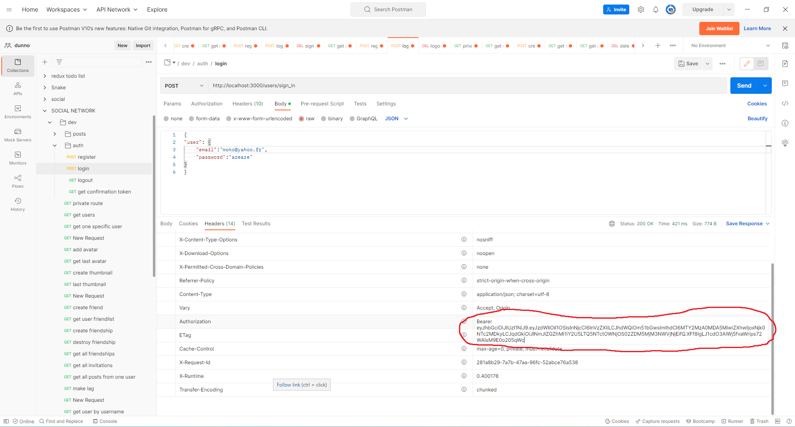

# Clonebook API

Backend du projet **Clonebook**, fournissant une API complète pour authentification, gestion utilisateurs et contenu social.

L’image ci-dessus montre l’utilisation de l’API via Postman avec authentification par bearer token (JWT).

Projet réalisé dans le cadre de mon apprentissage fullstack, avec mise en place d’une API sécurisée, logique métier et persistance des données.
